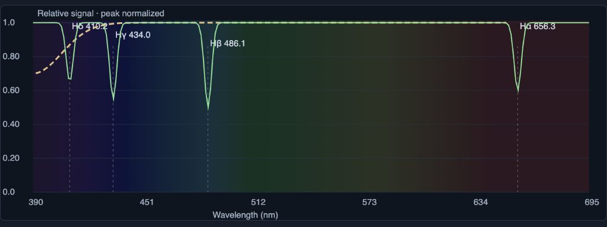

# SpectraCave

### Explore the science hidden in starlight.

**[Download the beta](https://github.com/ModDayJob/SpectraCave/releases/download/v0.3.0-beta.1/SpectraCave-0.3.0-beta.1.zip) · [Watch the promo](https://github.com/ModDayJob/SpectraCave/releases/download/v0.3.0-beta.1/SpectraCave-Explore-the-Light-v3-landscape.mp4) · [Getting started](docs/BETA_GUIDE.md#get-started)**

Free for noncommercial use · Public beta **0.3.0-beta.1** · **Python 3.10+ required**

Your telescope captures light. SpectraCave helps you investigate the clues inside it.
Turn your spectroscopic FITS captures into graphs, choose the stars you want to
compare, and explore possible absorption and emission features. Start with a
simple measurement; open the deeper science tools when you're ready.

Built for curious observers, astronomy clubs, and educators exploring how
measurements become evidence.

## What can you explore?

- **Make a spectrum.** Select a star's white, undispersed image and check the
  extraction settings. SpectraCave reports usable frames and measurement checks.
- **Choose your comparison.** Display your selected stars, add a reference curve,
  and compare in pixel or calibrated wavelength view.
- **Investigate possible features.** Fit a reference-star wavelength calibration,
  inspect laboratory guides, and examine repeatability and uncertainty.
- **Keep the evidence.** Export spectrum CSVs and evidence JSON. Original FITS
  captures stay untouched; calibrated results are created as copies.

*Actual beta interface with synthetic teaching data. Wavelength colors are
illustrative. Reference guides and repeating features do not confirm chemical identities.*

## Start exploring

1. **Download and extract** the [app ZIP](https://github.com/ModDayJob/SpectraCave/releases/download/v0.3.0-beta.1/SpectraCave-0.3.0-beta.1.zip).
2. Install [Python 3.10 or newer](https://www.python.org/downloads/), then use
   `Launch.command` on macOS, `Start.bat` on Windows, or `python3 start.py` on Linux.
3. Choose your observing folder, find your captures, and select a star.

The first launch needs internet to install NumPy and Pillow. The workbench then
runs locally in your browser. The download includes source and launch scripts;
see the [step-by-step beta guide](docs/BETA_GUIDE.md#get-started) for setup and troubleshooting.

**You'll need spectroscopic captures:** uncompressed 2-D primary FITS images
with an undispersed star image and a usable, separated spectrum from a grating.
A regular sky photograph can inspire a question; spectral measurements are
needed to investigate composition. Initial development used an ASI585MC and SA200;
other equipment has not been broadly validated.

## Learn with Fred and TomatoGirl

| How-to | Length | Watch |
| --- | --- | --- |
| Your first spectrum | 1:18 | [Landscape](https://github.com/ModDayJob/SpectraCave/releases/download/v0.3.0-beta.1/SpectraCave-howto-first-spectrum-landscape.mp4) · [Vertical](https://github.com/ModDayJob/SpectraCave/releases/download/v0.3.0-beta.1/SpectraCave-howto-first-spectrum-vertical.mp4) |
| Calibrate and compare | 1:36 | [Landscape](https://github.com/ModDayJob/SpectraCave/releases/download/v0.3.0-beta.1/SpectraCave-howto-calibrate-compare-landscape.mp4) · [Vertical](https://github.com/ModDayJob/SpectraCave/releases/download/v0.3.0-beta.1/SpectraCave-howto-calibrate-compare-vertical.mp4) |

The tutorials use labeled synthetic examples. The
[how-to and teaser download pack](https://github.com/ModDayJob/SpectraCave/releases/download/v0.3.0-beta.1/SpectraCave-Howtos-and-Teasers.zip)
includes the videos and a synthetic calibration exercise you can try yourself.
For short clips and sharing material, visit [Share SpectraCave](docs/MEDIA.md).

## Curious about the science?

SpectraCave helps you investigate **possible** features. The beta does not
independently confirm elements or measure elemental percentages, temperature,
or radial velocity. Observer-assigned calibration remains provisional, and
instrument and atmospheric effects can shape a spectrum.

Read [How the measurements work](SCIENCE.md) for methods and limits, or open the
[full beta guide](docs/BETA_GUIDE.md) for supported files, calibration, and advanced controls.

<strong>Optional AI, privacy, and AAVSO</strong>

Local extraction and comparison work without an AI account. Optional AI review
sends numerical evidence and sampled profiles to OpenAI only when requested;
provider API charges may apply. It offers AI perspectives, not human expert
sign-off. [Privacy details](PRIVACY.md).

The app links to AAVSO resources. AAVSO API access, 1-D reference FITS import,
and submission-ready FITS export are not implemented in this beta. AAVSO and
NIST do not endorse SpectraCave. [Full beta details](docs/BETA_GUIDE.md#aavso).

## Help shape the beta

[Ask a question or report a problem](https://github.com/ModDayJob/SpectraCave/issues/new/choose).
Include your setup and the steps you tried. Please keep credentials and private
observing information out of public reports.

Free for noncommercial use under [PolyForm Noncommercial 1.0.0](LICENSE).
Donations are welcome; no payment is required. See the license for its exact permissions.

*Astrophotography by Brother Fred. Promo and tutorial narration uses
ElevenLabs-generated Fred and TomatoGirl voices.*
