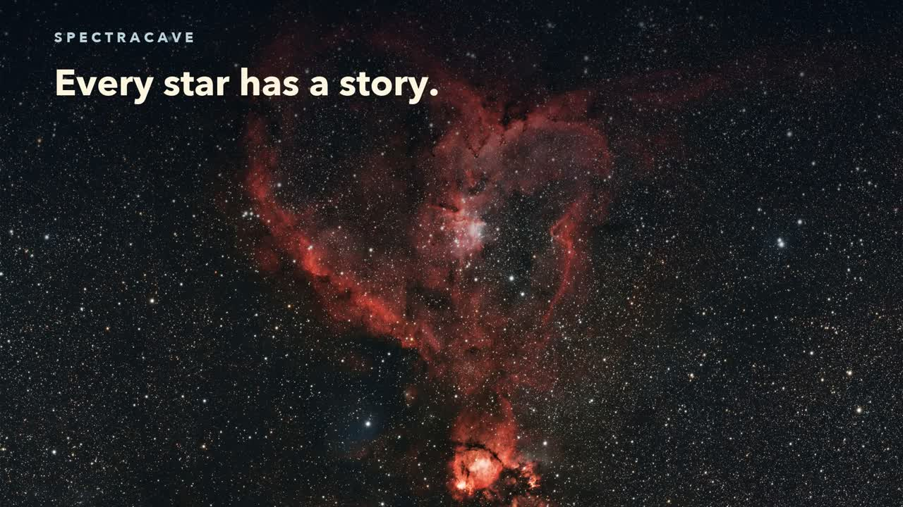

# Share SpectraCave

**Explore the science hidden in starlight.**

SpectraCave is a local spectroscopy workbench for curious astronomers. Extract
spectra from suitable FITS captures, compare selected stars and a reference,
and investigate possible spectral features while keeping the evidence in view.

**Project:** [github.com/ModDayJob/SpectraCave](https://github.com/ModDayJob/SpectraCave)

**Download:** [SpectraCave public beta](https://github.com/ModDayJob/SpectraCave/releases/download/v0.3.0-beta.1/SpectraCave-0.3.0-beta.1.zip)

Free for noncommercial use. Python 3.10+ required; first launch needs internet.
The beta includes source and local launch scripts for macOS, Windows, and Linux.

## Featured promo — Explore the Light

The featured 41-second cut uses steady visuals, an inviting conversation,
a Heart Nebula photograph from Advent Skies Observatory, and actual app screens with labeled
synthetic data.

- [Landscape HD, 1920 × 1080](https://github.com/ModDayJob/SpectraCave/releases/download/v0.3.0-beta.1/SpectraCave-Explore-the-Light-v3-landscape.mp4)
- [Vertical HD, 1080 × 1920](https://github.com/ModDayJob/SpectraCave/releases/download/v0.3.0-beta.1/SpectraCave-Explore-the-Light-v3-vertical.mp4)

## Short teasers

- **A question in the light · 14 seconds** — [Landscape](https://github.com/ModDayJob/SpectraCave/releases/download/v0.3.0-beta.1/SpectraCave-teaser-starlight-landscape.mp4) · [Vertical](https://github.com/ModDayJob/SpectraCave/releases/download/v0.3.0-beta.1/SpectraCave-teaser-starlight-vertical.mp4)
- **Your stars, your questions · 14 seconds** — [Landscape](https://github.com/ModDayJob/SpectraCave/releases/download/v0.3.0-beta.1/SpectraCave-teaser-compare-landscape.mp4) · [Vertical](https://github.com/ModDayJob/SpectraCave/releases/download/v0.3.0-beta.1/SpectraCave-teaser-compare-vertical.mp4)

[Download both teasers, the two longer how-tos, and a synthetic calibration exercise](https://github.com/ModDayJob/SpectraCave/releases/download/v0.3.0-beta.1/SpectraCave-Howtos-and-Teasers.zip).

## Suggested introduction

Ever wondered what starlight can tell us? SpectraCave helps curious observers
turn spectroscopic FITS captures into spectra, compare their stars, and
investigate possible features. Start with a question. Follow the evidence.
Explore the public beta, free for noncommercial use.

## Keep the science accurate

- Describe chemical features as possible features or candidates. SpectraCave
  does not automatically confirm elements or measure elemental percentages.
- Identify synthetic demonstrations as teaching data. The telescope photograph
  inspires the question; it is not itself a measured spectrum.
- Include the public-beta status and Python requirement when promoting the download.
- AAVSO integration and submission-ready export are future work.

Created by **The AstroCave Team**. Astrophotography by **Advent Skies Observatory**.
The app, demo imagery, and measurement methods are described
in the [beta guide](BETA_GUIDE.md), [science notes](../SCIENCE.md), and [license](../LICENSE).
