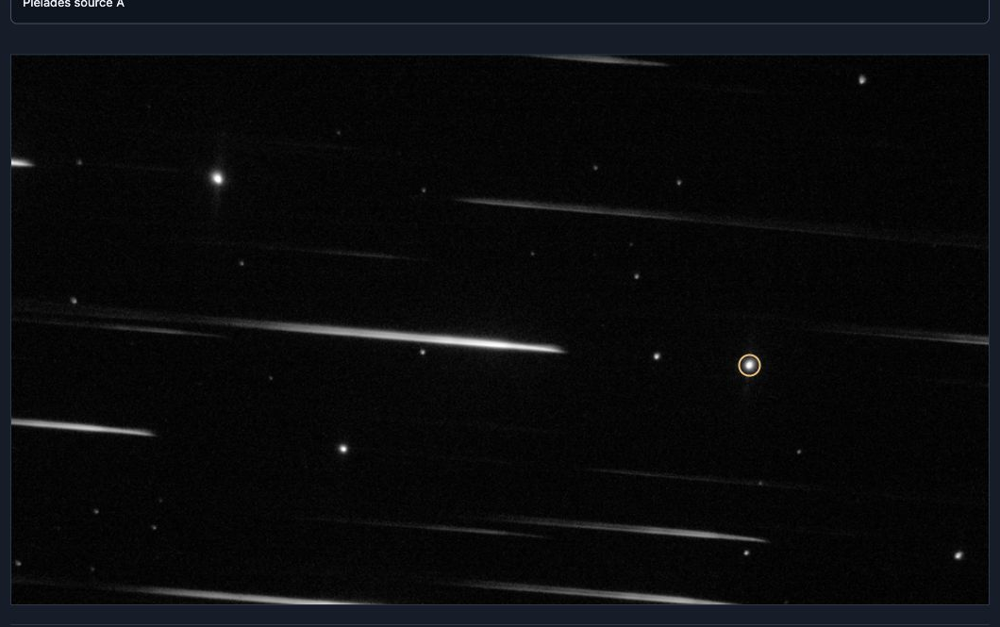
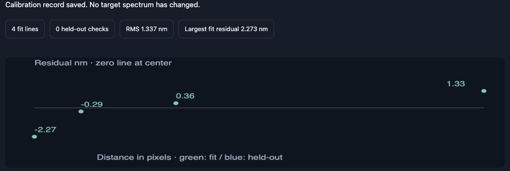

# Actual observations — 18 October 2026

**Observations and astrophotography: Advent Skies Observatory.**  
**Project: The AstroCave Team.**

The featured plots, app examples, and tutorial spectrum fields use the saved
measurements and actual FITS captures from this observing session. No artificial
absorption dips or simulated stellar spectra were added.

## The observing data

| Observer label | Usable / input frames | Displayed wavelength status |
| --- | --- | --- |
| Pleiades source A | 34 / 34 | Provisional transferred scale |
| Mirach | 30 / 30 | Provisional transferred scale |
| Aldebaran | 92 / 92 | Provisional transferred scale |
| Betelgeuse | 47 / 76 | Uncalibrated; pixel-distance view only |

Names are observer-supplied labels, not independent catalog identifications.
Pleiades source A identifies an image position in the M45 field; individual
catalog identity and cluster membership were not established.

The preview above comes from the actual M45 captures. The app displays an
intensity image for source selection; it is not a fabricated star field.
The opening Heart Nebula photograph in the promo is a separately supplied
Advent Skies Observatory photograph, not a claim about that night's spectrum.

## The historical reference fit

The saved original-focus reference profile is observer-labeled Menkalinan and
combines six 0.2-second exposures. The recorded proposed Balmer assignments were:

| Proposed assignment | Original-pixel distance | Historical rounded wavelength |
| --- | --- | --- |
| H alpha | 1322 | 656.28 nm |
| H beta | 978 | 486.13 nm |
| H gamma | 872 | 434.05 nm |
| H delta | 820 | 410.17 nm |

The through-zero fit gives approximately **0.4974359 nm per original pixel**.
The largest internal fit residual is about **2.3 nm**. All four assignments were
used in the fit: **no held-out line check was recorded**. These are the actual
saved assignments, including their limitations; they are not a simulated
perfect calibration or an independently validated wavelength solution.

The promotional examples preserve the saved Pleiades, Mirach, Aldebaran, and
Betelgeuse sample arrays. Reference samples are ordered by increasing pixel
distance for display. Graphs may normalize intensity and use illustrative
wavelength colors; those colors are not measured true-color photographs.

## What the evidence supports

The Pleiades spectrum has structure near proposed hydrogen reference regions.
For example, the current local screen finds a minimum around 432.77 nm with
roughly 11% contrast relative to its chosen continuum. Screen classifications
and subset results must be read alongside the profile, rather than treated as
confirmed chemistry. A local dip, good repeatability, or wavelength coincidence
does not establish an element or an elemental percentage.

No independently validated reference-to-target transfer, dark/flat correction,
atmospheric correction, or instrument-response correction has been added.
Instrument structure and spectral overlap can also repeat. No abundance,
temperature, radial velocity, or definitive chemical identification is claimed.

## Download the measured evidence

[Download the actual spectrum CSVs, evidence JSON, reference record, and checksums](https://github.com/ModDayJob/SpectraCave/releases/download/v0.3.0-beta.1/SpectraCave-Observed-Evidence-20261018.zip).

The files include source hashes for traceability. Public evidence copies omit
per-frame filenames. Original observing files and headers are not bundled.
Read the [measurement methods](../SCIENCE.md) and [privacy notes](../PRIVACY.md)
for context.
